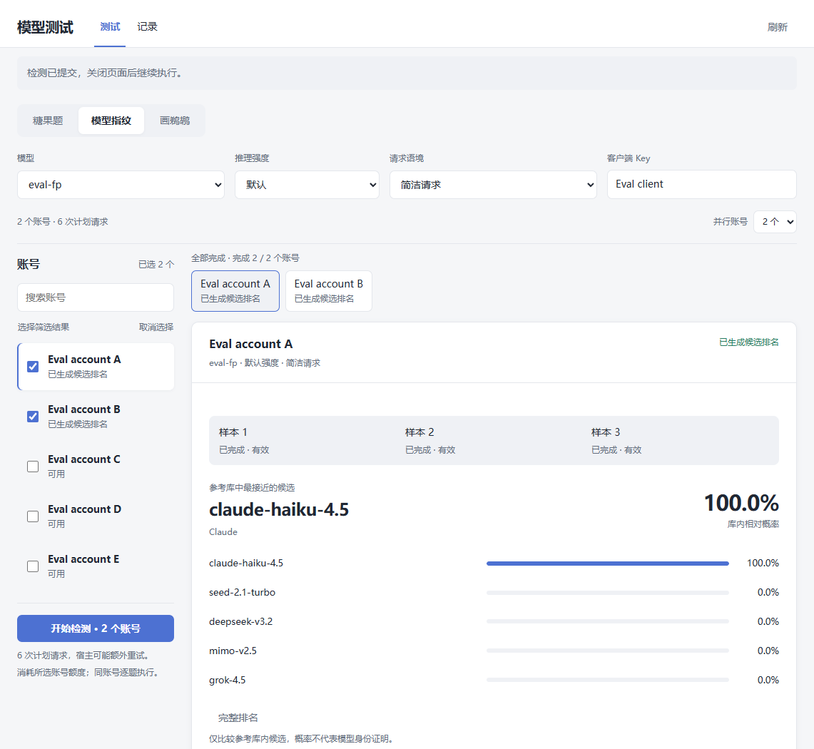

# 1.3.0 工作台、批次与多账号并行验收

本机时间 2026-11-04—11-05，按确认的产品方案完成本地完整版本；UTC 时间戳见各项证据。入口为“测试 / 记录”，请求字段直接可见；糖果展示答案与有效分母，指纹展示样本和库内候选，绘图默认标准 SVG v1。一次点击对应批次，同账号多次糖果归在一起；旧 HTML 题和旧冻结任务不改写。默认简洁请求，可显式选择原 Codex 上下文 v1。没有增加健康评分、自动禁用、定时检测或独立服务。

最终归档 SHA-256：`a488ed3a0406f8ffb08fe010ba307b3cb80b940f3b8eabb79cb8e0a8d771bce1`，6691068 字节，Linux x86_64、GLIBC_2.28。包内网页资源与当前生产构建逐字节一致，旧五个状态声明原样保留，新增 batches。以下新证据都指向此摘要；本地安装包尚未推送或公开发布。

- 37 项 Rust 检查、fmt、全目标 clippy -D warnings、生产前端构建及 16 项 CSP 页面交互检查通过。覆盖创建两阶段中断恢复、初次批次提交失败后的索引去重、停止账号所有重复、原样本恢复、未知消费不重放、禁用浏览器存储以及多个页面草稿冲突。
- 官方 CPR 3.36.0 全新临时库使用原始 1.2.1 创建旧报告和暂停任务，再在原实例切换最终归档，核对历史、详情、冻结计划与样本保持，旧暂停请求无自动重发。然后按升级方向在 3.38.2、3.39.0 核对相同最终归档、旧状态、账号与模型目录、糖果 21 和三样本指纹。版本身份来源为启动时注册的发布目录及程序 SHA-256，不把外部更新检查接口当成业务依赖。
- 五账号与跨批次受控账本核对全局并行上限 2、同账号峰值 1；快账号补入新题不等待慢账号。两账号各三次糖果、第三份指纹无效后只补一次通过。停止一个账号覆盖其所有剩余重复并释放实际 Core 租约，兄弟账号继续；停止批次的范围持久保存。
- 真实插件禁用/启用后，未确认请求暂停且不自动重发。165 秒受控绘图完整完成一次，保留成功终态、SVG、usage 和请求 ID，跨过旧 150 秒时限。15 子任务加已有暂停项填满 16 份保护上限，新增请求在消费前拒绝；显式 Codex 上下文的长指令、工具声明与关闭工具执行均由受控上游核对。
- 真实 CPR 3.39.0 iframe/CSP 中从界面启动双账号指纹，恰好六次受控请求，完成后直接显示排名；报告复制回退包含全部三个样本和来源摘要。刷新不增加请求，原生主题切换、SVG 解码、390px 布局通过；独立页面另覆盖 320px、旧 HTML 作品、不可执行外链/脚本及已有作品对比。
- 本轮最终环境共 59 次本机受控调用，**没有新增真实模型请求、提取生产 Key、安装线上插件或改变出口**。受控数据只证明协议、保存、调度与交互，不证明指纹识别准确率。临时数据库、控制凭据及自建服务均已清理。

[完整证据](verification-1.3.0.json)、[宿主身份](native-hosts-1.3.0.json)、[原生页面验收](workbench-ui-1.3.0.json)、[清理检查](credentials-cleanup-1.3.0.json)。中间构建的原生页面曾暴露 localStorage 在宿主不透明 iframe 中不可用，导致提交前被阻止且未发请求；已改成宿主私有状态和版本比较，并增加回归。安全 SVG 预览同时保留内部渐变引用。最终包重新从旧实例升级验收，早先中间构建结果不冒充最终包证据。Windows 预览进程退出曾等待，清理专用进程后通过，最后一次完整页面检查正常退出。

---

# 1.2.1 鹈鹕长响应修复

2026-11-03：用户报告 high 强度的两次鹈鹕测试在约 2.5 分钟取消。只读查线上用量，分别为 149994 / 150000 ms、logicalOutcome=cancelled，最终 input/output tokens 均缺失。插件 1.2.0 对所有测试硬编码 150 秒等待，并主动关闭流；本次用实际旧包复现了同一故障路径。原线上任务已不在可读任务列表，不能补造其诊断，也不将取消解释为账号或上游容量故障。

鹈鹕等待上限改为 600 秒，糖果/指纹保持 150 秒；维护预算 630 秒、旧同步管理调用预算 620 秒。发请求前按测试类型预留完整窗口加 10 秒收尾。达到插件时限时报告明确标出来源与秒数，不伪装成宿主错误；缺失最终用量不填零、不代表未消耗额度。旧暂停任务保留，升级不自动重试。绘图预览改为读取成功的有效样本，避免首次失败后续测成功仍没有图片。

最终安装包 SHA-256：`646b554d85dd17b50e2e5d1c307212776efd8ba3db4928e7c3ca85f8b1559c07`，6593580 字节，Linux x86_64、GLIBC_2.28。以下原生检查使用同一最终归档。

- 原始 1.2.0 在真实 CPR 3.38.2 面对 165 秒受控 SVG，在 150004 ms 取消、暂停，无最终 usage；最终 1.2.1 在真实 CPR 3.39.0 面对同样 165 秒延迟的受控 SVG，165013 ms 完整完成，保存 SVG、成功终态、usage 和请求 ID。每个对照仅一次受控请求，上游账本核对无重发。
- 原实例从 1.2.0 升级，暂停任务和已保存样本逐项不变，没有自动重试；私有状态声明保持不变。[升级证据](pelican-upgrade-1.2.1.json)。
- 30 Rust 检查、fmt、全目标 clippy -D warnings、生产前端构建及 10 项 CSP 页面检查通过。新增虚拟时间回归覆盖跨旧时限完成、600 秒终止暂停与无重试、完整执行预算不足时不发请求；页面覆盖首次超时后第二次成功的预览。
- CPR 3.36.0、3.38.2、3.39.0 的最终归档加载、旧状态、账号/模型目录、幂等糖果及三样本指纹评分通过；3.37.2 的既有验证属于 1.2.0，未伪装成本次包的实测。兼容声明 >=3.36.0,<3.40.0，不声明未来 minor 版本。
- CPR 3.39.0 原生 iframe/CSP、报告与导出、刷新、深色主题与 390px 布局通过；另用原始 1.2.0 的不完整绘图创建暂停任务，升级后手动续测 165 秒完整完成，真实页面显示 SVG，导出同时保留两次尝试。停止后的实际 Core 租约归零。临时宿主退出后删除测试数据库及控制凭据，另保留清理观察。
- 固定 92 个来源文件校验通过；原糖果题、指纹算法、数据、SVG 隔离规则没有变更。本轮没有发送真实模型请求、安装生产插件或修改线上路由。

完整结构化证据：[verification-1.2.1.json](verification-1.2.1.json)。较早一次隔离宿主从 3.39.0 同库回退至 3.36.0 时启动退出，已自动清理；没有保留详细退出原因，不归因为数据库 schema。最终矩阵使用全新 3.36.0 库按升级方向验收，不将此作为生产降级验证。最终慢检测本身已完成，但测试进程末尾的全局异步账本差值断言失败；已用只读 `pelican-audit.py` 补核持久任务、两个样本及该模型恰好两次夹具调用，没有重发慢请求，恢复过程保存在结构化证据。脚本已改为等待快照落盘并仅统计当前模型。下面保留历史版本记录，其旧时限与兼容范围不代表本版。

---

# 1.2.0 后台任务与完整检测流程验收

2026-11-02：完成持久化任务、维护回调执行、冻结计划、样本归属、失败暂停和手动续测，以及任务/历史/报告页面改造。糖果固定按 **21** 判分；检测器与题库保持原固定版本。

最终归档 SHA-256：`eb4d96089629c3964cf8c83e308804d43cd6ce8af9c144ced455ffdb2f338e93`，6592438 字节，Linux x86_64、最高要求 GLIBC_2.28。后端程序摘要与工具链见 [toolchain-1.2.0.json](toolchain-1.2.0.json)。同一个归档已用于下列升级、版本与真实请求验收，不复用早期候选包的摘要。

- 27 项 Rust 测试、fmt、全部目标 clippy -D warnings；前端生产构建与 8 项 CSP 页面测试通过。包含稳定身份的凭据刷新、身份变化拒绝、后续题目失败保留有效样本、未知消费不自动重放，以及结果已落盘但任务提交失败窗口中的恢复、停止和删除。
- 原始发布包 1.0.0 在真实 CPR 3.35.1 写入历史，同库升级到 3.36.0 后直接迁移最终 1.2.0；另建原始 1.1.2 实例写入分片摘要与详情，再切换最终 1.2.0。两条路径均逐项保留原内容。[升级证据](upgrade-1.2.0.json)。
- 官方 CPR 3.36.0、3.37.2、3.38.2，同库逐级验证最终归档加载、账号/Key/模型目录、旧状态、幂等糖果和完整三样本后台评分。包声明 >=3.36.0,<3.39.0，不表示逐个验证范围内每一个 patch；未声明未来 minor 兼容。
- CPR 3.38.2 中 12 项后台生命周期检查通过；另单独观察真实 Core 租约被占用，再确认停止后归零。[流程与持久状态账本](tasks-3.38.2.json)、[租约证据](cancellation-1.2.0.json)。流程脚本全部检查通过后，末尾版本刷新曾超时；已按先前版本观测、16 份终态任务和 27 次受控上游 POST 补核报告，脚本改为版本快照及逐项落盘，说明保留在证据中。
- 真实宿主 iframe/CSP、指纹排名与完整证据导出、刷新恢复、宿主深色主题与 390px 窄屏通过。[页面记录](tasks-ui-3.38.2.json)、[报告截图](native-1.2-report.png)、[深色窄屏](native-1.2-dark-mobile.png)。新版主题同时识别 cp 与 z 变量，移除旧组件全局样式造成的外层底色冲突。
- 用户明确授权请求预算及临时凭据使用后，在本机 CPR 3.38.2 经既有模型服务完成 **4 次插件级真实请求**：gpt-6.1-sol 糖果答对，指纹 3/3 有效并完成候选排名。报告仅保留状态、数字统计、回答摘要和用量，不公开原始回答或凭据。[真实请求证据](real-model-1.2.0.json)。
- 临时数据库和控制凭据已在隔离宿主退出后验证删除；临时 Key 副本随数据库删除，生产 Key 未修改。[清理证据](credentials-cleanup-1.2.0.json)。未安装生产插件、更新镜像、调整出口、重启生产服务或新增自动检测。

这些检查证明执行、保存、恢复、展示与宿主集成。受控数据与单次真实检测均不能证明指纹识别准确率；库内候选概率不等于真实模型身份。4 次插件调用不等于已知上游 attempt 总数。

结构化汇总：[verification-1.2.0.json](verification-1.2.0.json)。以下为历史版本记录，其旧版限制不代表 1.2 的能力；此前“父调用限制导致无法后台执行”的归因撤回，maintenance 提供合法的任务推进父调用。

---

# 1.1.2 大响应与错误诊断修复

2026-11-01：用户截图中的线上 1.1.1 指纹记录耗时 40395 ms，status=capacity，requestId=null。只读确认该记录存在；旧版没有保存宿主细分原因，未能将它关联到 Core 请求，不能断言线上这次一定由响应缓冲造成。

本轮确认并修复了一条可复现的相同故障路径：旧版调用 host.model.execute 将整轮原始事件编码为 HME1，超过宿主预算时只返回 Capacity，无法返回请求 ID；并将所有 Capacity 统一标为“宿主容量限制”，丢失细分事实。

## 修复与验证

- 改为 host.model.execute_stream / stream_read / stream_close，同一父调用内逐块处理，只保留文本、用量和终态计数，丢弃已经处理的原始 wire/reasoning，不额外重试或换号。
- 失败、取消、超时保留已经取得的请求 ID，区分队列满、排队超时、账号容量、限流、无 Provider、整轮缓冲或单事件过大。未知 Capacity 明确显示具体原因未提供。
- 受控上游生成 800 个含 8192 字节扩展字段的空文本事件，再输出完整答案 21。原始发布包 1.1.1 返回 capacity 且无请求 ID；1.1.2 对同一响应完整完成，答案、usage 和请求 ID 保留。夹具不使用无效 reasoning 事件序列。
- Rust 18 项测试、fmt、全目标 clippy -D warnings、生产前端构建及 8 项页面测试通过。新增跨分块终态检查、大事件历史丢弃和错误信息安全保留测试。
- 真实 CPR 3.36.0：20 项既有业务/生命周期/历史检查、大响应旧新对照、6 项原生页面检查通过，含取消后的账号租约释放、权限、指定账号、中断、1.1.1 回退再返回及历史保留。
- history/details 状态声明完全沿用 1.1.1，不引入新 schema。1.1.1 到 1.1.2 原生版本切换及回退通过；旧版 1.0.0 迁移沿用下方已验证路径。
- 线上只读核对，没有安装生产插件、改变并发/出口、重启生产服务或发送真实模型请求。测试宿主与假账号位于本地 WSL，结束后清理。

机器证据：[streaming-1.1.2.json](streaming-1.1.2.json)。复现：在 integration/run_host.py 的本机受控环境中，先用 1.1.1 初始化，再运行 integration/streaming.py；详见 integration/README.md。

以下保留既有状态迁移与功能验收的历史证据。

# 1.1.1 状态升级修复验收

2026-10-31：已使用原始发布包 1.0.0、1.1.0 和修复包 1.1.1，在真实 CPR 中验证状态升级。

- 原版 1.0.0 在官方 CPR 3.35.1 写入糖果结果；临时数据库保持不变，将宿主升级到官方 3.36.0。
- 切换 1.1.0 返回原始状态冲突；停用后再切换仍冲突，与用户现象一致。
- 切换 1.1.1 成功，原有记录作为 JSON 逐项完全相同；旧详情可读，新结果能写入，停用后启用仍保留。
- 独立 1.1.0 实例写入摘要与详情后切换 1.1.1，两者均原样保留。
- Rust 16 项测试、fmt、全目标 clippy -D warnings、前端生产构建通过；真实原生页面的糖果、指纹、SVG、JSON、刷新、主题和窄屏检查通过。
- 本轮未操作线上数据库、未安装生产插件、未调用真实模型。迁移依赖 CPR 的暂存与原子提交；插件返回 Keep，不清理或改写历史内容。

根因是 history schema 的 maxItems 从 20 改为 200，但 schemaVersion 保持 1 且 migratesFrom 为空。宿主同时比较版本和 schema 摘要；数据内容即使兼容，也不能省略迁移声明。1.1.1 的 history 为版本 2，声明从版本 1 迁移并注册正式处理器。details 的 schema 和版本保持不变。

机器证据：[migration-1.1.1.json](migration-1.1.1.json)。复现步骤见 [integration](../integration/README.md#旧状态升级回归)。

以下为 1.1.0 功能验收的历史记录，其中“未验证旧包切换”是该轮遗漏，不作为 1.1.1 的升级证据。

## 1.1.0 功能验收记录

观察日期：2026-10-31（北京时间）。使用官方 CPR v3.36.0 Linux amd64 二进制，归档 SHA-256 `40fb64827603fb6caad08f031180b3672f5e9836b98c933d193d89a80c43f126`，按官方 checksums.txt 校验。环境为本机 Ubuntu 24.04 / WSL2、临时 PostgreSQL 16.15、Redis 7.0.15 和 Chrome。

模型请求经过真实 CPR Core 和 Provider，到本机受控 Responses 上游。使用临时假账号和 Key，不连接生产数据库、不调用真实模型。该验证证明业务与宿主集成行为，不证明模型身份或指纹鉴别准确率。

## 已通过

- Rust 14 项测试、fmt、全目标 clippy `-D warnings`；TypeScript/Vite 生产构建及 8 项页面测试。
- 真实宿主 19 项业务检查：安装、历史保留、糖果 21、完整终态及用量、重复提交、三题指纹、绘图、错误和缺失终态、并发与取消、Core 账号租约释放、题间取消、禁止换号、停用恢复、Key 范围及 Core 实际选号、进程替换中断、分组历史上限、请求语境与定向清理。
- 在实际受控上游核对 Codex 上下文：基础指令超过 20000 字符、多条上下文消息、工具声明均经过 Core；tool_choice 为 none。换语境重用相同执行 ID 被拒绝。
- 连续对账号 A 执行 21 轮后，该账号糖果保留 20 条，账号 B 的历史仍在；清理 A 的糖果记录后 B 保留。
- 真实原生 iframe 页面：资源和 CSP、糖果与 JSON、三题指纹排名、SVG 图片及放大、刷新恢复、明暗主题和 390px 窄屏通过，无页面脚本错误。实际截图位于本目录。
- 92 个固定来源文件的摘要通过，检测器及公开样本离线评分通过；正式 Linux x86_64 安装包经过官方 CLI 和独立校验脚本检查。

机器可读检查清单见 [verification.json](verification.json)，复现见 [integration](../integration/README.md)。

## 当前边界

兼容范围仅声明 CPR >=3.36.0, <3.37.0。此轮未在 3.36.0 上安装旧的 1.0.0 包或跨版本回退：旧包声明不支持 3.36.0，不能绕过宿主检查。旧结构记录在 SDK 用例中保持可读；同版本停用恢复与运行时替换已在真实宿主验证。

Codex 上下文来自固定的上游 0.163.0 上下文快照，按 CPR Responses 合同适配；不声称复制 Responses Lite 的完整线上编码和身份头。工具不会执行。记录区分语境版本，Codex 语境另保存来源 SHA-256。历史统计仅针对当前保留记录。

历史每账号每种测试最多 20 条，全局最多 200 条，摘要约 220 KB、详情总量约 15 MB；每条详情单独保存，展开和导出时按需读取。清理和淘汰会删除对应详情。容量不足时旧记录提前淘汰，不能保证每个账号始终拥有完整 20 条。旧的平面历史仍可读取。

宿主管理桥的单请求边界是 180 秒，模型回调受父调用寿命约束。本版本保留模型 150 秒及管理 170 秒预算，没有实现十分钟后台任务或断线自动续跑。取消和未知消费结果均不自动补发。长后台任务是仍未完成的优化项，不计入本轮已通过能力。

Core attempt 投影可能标记 attemptsComplete=false，插件仍将完整尝试总数及实际账号保留为未知；真实选号以请求 ID 对应的 Core 事实核对。测试没有修改生产实例、账号或出口。
